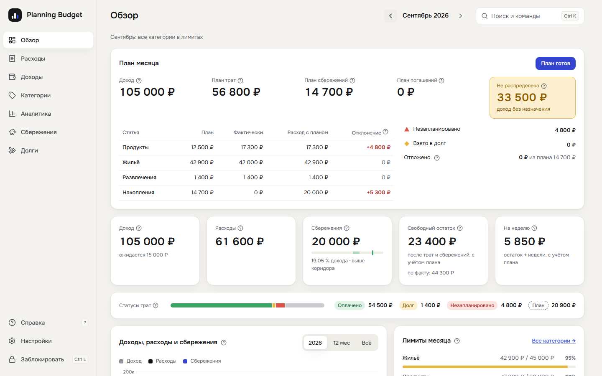
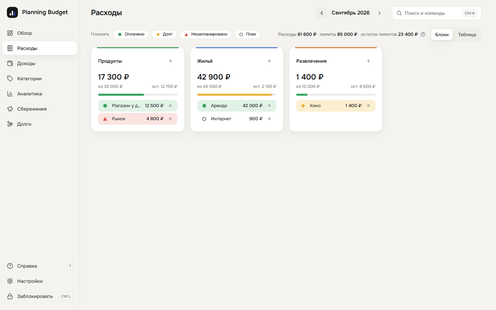
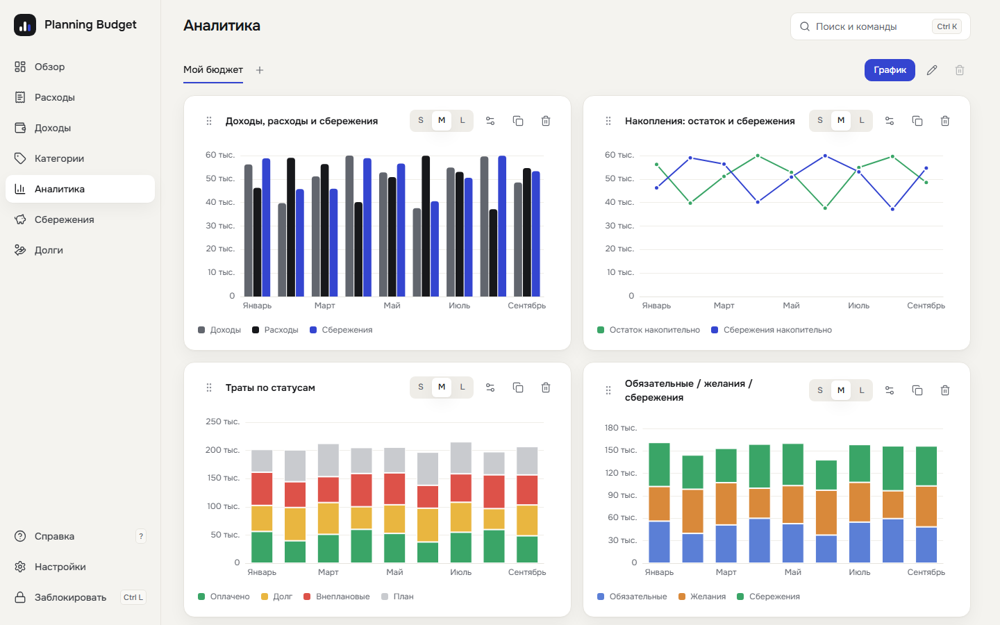
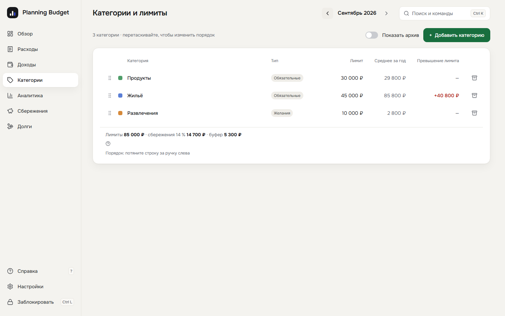
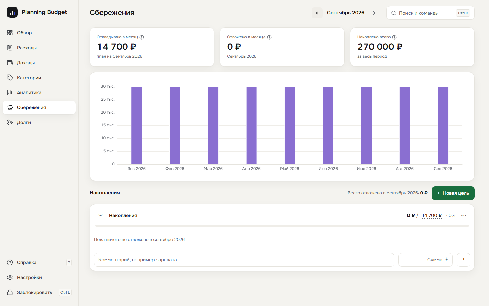
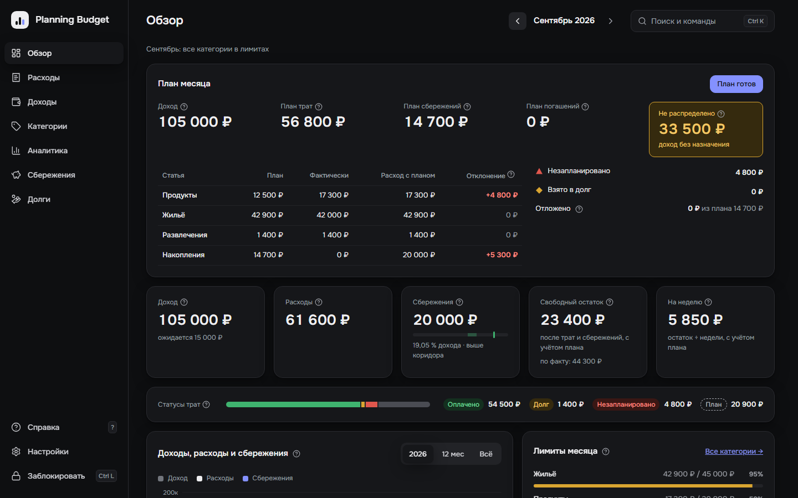
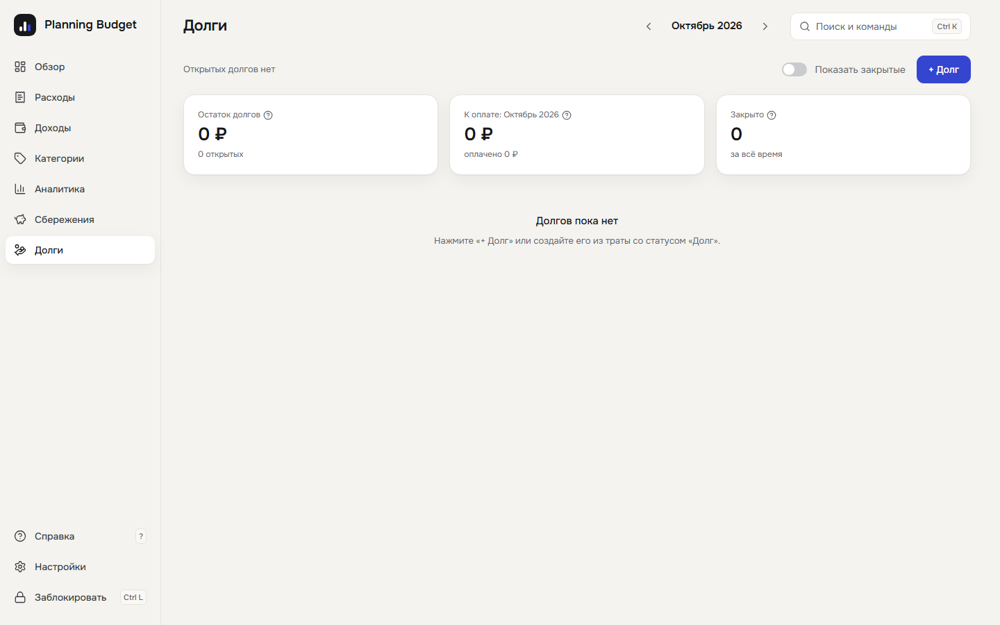

# Planning Budget

Настольное приложение для личного бюджета. Месяц начинается с плана: вы вносите доход, распределяете его по статьям расходов, накоплениям и погашению долгов, потом отмечаете, что реально произошло, и видите, где план разошёлся с фактом. Приложение рассчитано на одного человека и один компьютер.

Все данные лежат только на вашем компьютере, в базе, зашифрованной вашим паролем. Облачного аккаунта и синхронизации нет. Единственное обращение в сеть — проверка обновлений на GitHub, её можно отключить (см. «Безопасность и приватность»).



<table>
  <tr>
    <td></td>
    <td></td>
  </tr>
  <tr>
    <td></td>
    <td></td>
  </tr>
  <tr>
    <td></td>
    <td></td>
  </tr>
</table>

## Что умеет приложение

Слева в меню девять разделов.

- **Обзор.** План месяца и главная цифра «Не распределено». Ниже таблица «план → факт» по статьям, ключевые показатели месяца, график доходов, расходов и сбережений по месяцам, список лимитов, отсортированный по степени использования.
- **Расходы.** Траты по месяцам, переключатель «Блоки» (карточки категорий) и «Таблица». У каждой траты есть статус: «Оплачено», «Долг», «Незапланировано» или «План». Статус отличается и цветом, и формой значка. К тратам можно добавлять комментарии и теги. Накопления здесь не показываются: они ведутся на экране «Сбережения», а в итоги месяца входят.
- **Доходы.** Ожидаемые и полученные поступления месяца; доход можно изменить и удалить.
- **Категории.** Свой набор статей расходов, лимиты с историей по месяцам («с октября лимит 8 000»), цвет, порядок, архив.
- **Аналитика.** Графики, которые вы настраиваете сами: тип (столбцы, линия, область, кольцевая диаграмма, таблица, число), показатель, разбивка, период, фильтр. Графики собираются в дашборды.
- **Сбережения.** Накопления с целью: суммы откладываются по месяцам несколькими строками, видно «Накоплено всего» и график по месяцам. Достигнутую цель можно закрыть и при необходимости вернуть.
- **Долги.** Заём и график погашения: равными частями или одним платежом. Долг можно создать прямо из траты со статусом «Долг». Погашение попадает в план месяца отдельной строкой и не считается расходом.
- **Справка.** Короткий рассказ о том, как устроен месяц, и список горячих клавиш.
- **Настройки.** Тема, режим «меньше анимаций», проверка обновлений, автоблокировка, смена пароля, перевыпуск ключа шифрования.

Дополнительно:

- **Поиск и фильтры.** Палитра **Ctrl K** (на macOS ⌘ K) ищет по тратам, доходам и категориям и выполняет команды. В строке поиска работают условия: `статус:оплачено`, `сумма>5000`, `период:июн..сен`, `категория:Продукты`, `#тег`. Фильтры можно сохранять.
- **Клавиатура.** **1…7** — разделы, **←** и **→** — месяц, **T** — текущий месяц, **Ctrl Z** и **Ctrl Shift Z** — отмена и возврат действия, **Ctrl L** — блокировка, **?** — справка.
- **Светлая и тёмная тема.**
- **Мастер первого месяца.** Спрашивает доход, суммы по статьям и накопления и сразу показывает «Не распределено». Новый месяц начинается с копии плана предыдущего.

## Чего пока нет

- Импорта банковских выписок. Траты вносятся вручную.
- Экспорта в таблицы и автоматических резервных копий. Копию можно сделать вручную (см. «Резервные копии»).
- Подключения к брокерскому счёту и учёта облигаций.
- Нескольких валют: все суммы в рублях.

## Как устроен месяц

1. **Доход.** Внесите ожидаемые поступления в «Доходах», по мере получения отмечайте их полученными.
2. **План.** Распределите доход: плановые траты по статьям (статус «План»), суммы накоплений, погашения долгов. «Не распределено» должно стать 0 ₽. Если число отрицательное, план превышает доход.
3. **План готов.** Нажмите «План готов»: приложение запомнит плановые суммы. Позже план можно разблокировать и поправить.
4. **Траты.** В течение месяца отмечайте, что произошло. Траты, добавленные после «План готов», по умолчанию получают статус «Незапланировано».
5. **Итоги.** В «Обзоре» по каждой статье видны план, факт и отклонение, а также незапланированное, взятое в долг и отложенное.

## Безопасность и приватность

- Данные хранятся в одном файле `budget.db`, зашифрованном SQLCipher (AES-256). Ключ базы защищён вашим паролем (Argon2id) и ключом восстановления.
- Телеметрии, внешних шрифтов и скриптов нет. Единственное обращение в сеть — проверка обновлений: при запуске приложение запрашивает список релизов на GitHub, не чаще раза в сутки. В запрос не входят ваши данные. Обновление ставится только после вашего подтверждения, подпись проверяется. Проверка отключается в «Настройки → Вид».
- Приложение блокируется после периода бездействия (по умолчанию 5 минут, настраивается), по **Ctrl L** и, если включить в «Настройки → Безопасность», при сворачивании окна.
- Три неверных пароля подряд включают нарастающую задержку, до 60 секунд. Данные при этом не удаляются.

## Установка

Установщики для Windows, macOS и Linux лежат на странице [Releases](../../releases). Скачайте файл для своей системы и запустите его. Установщики пока не подписаны, поэтому Windows SmartScreen и macOS Gatekeeper покажут предупреждение о неизвестном издателе: его нужно подтвердить вручную. Дальше обновления приходят из самого приложения.

## Первый запуск

1. Придумайте пароль не короче 10 символов. Приложение покажет **ключ восстановления** из 26 символов. Сохраните его отдельно от компьютера. Кнопка «Скопировать» кладёт ключ в буфер обмена, после вставки очистите буфер.
2. Приложение коротко расскажет, как оно устроено (можно пропустить), предложит выбрать стартовые категории («Сбережения» и «Прочее» остаются всегда) и пройти мастер первого месяца. Знакомство можно показать снова в «Настройки → Вид».
3. В «Категориях» задайте лимиты, переименуйте категории или добавьте свои.

## Где лежат данные

| Система | Папка |
|---|---|
| Windows | `%APPDATA%\planning-budget` |
| macOS | `~/Library/Application Support/planning-budget` |
| Linux | `~/.local/share/planning-budget` |

В папке:

- `budget.db` — вся база;
- `vault.json` — ключи: пароль и ключ восстановления оборачивают ключ базы, сам пароль нигде не хранится;
- `ui-prefs.json` — тема и другие настройки интерфейса, данных бюджета в нём нет;
- `logs/` — журнал работы: только коды и время операций, без сумм, названий и паролей.

Если у вас стоял Private Budget (папка `private-budget`), при первом запуске сейф, база и настройки копируются в новую папку. Старая остаётся нетронутой, после проверки её можно удалить вручную.

## Резервные копии

Автоматических копий в приложении нет. Чтобы сделать копию, закройте приложение и скопируйте **вместе** `budget.db` и `vault.json`: без второго файла первый не открыть. Копия остаётся зашифрованной и открывается тем паролем и ключом восстановления, которые действовали на момент копирования. Если вы потом смените пароль, копия по-прежнему откроется старым.

## Что будет, если потерять пароль

- Забыли пароль, но есть ключ восстановления: на экране входа выберите «Забыли пароль? Ключ восстановления», введите ключ и задайте новый пароль. Данные сохранятся.
- Потеряны и пароль, и ключ восстановления: **данные восстановить нельзя**. Это следствие шифрования, обходного пути нет.

## Известные ограничения

- Защита рассчитана на потерю или кражу компьютера и на доступ других людей к файлам. От вредоносных программ на разблокированном компьютере, перехвата клавиатуры и принуждения она не защищает.
- Пароль и ключ восстановления передаются из окна приложения во внутренний процесс обычной строкой, и их копии в памяти не затираются до выхода из приложения.
- Блокировка при сворачивании окна проверена на Windows. На macOS и Linux сворачивание может не распознаваться, тогда база остаётся открытой до срабатывания таймера бездействия.
- Второй запуск не открывает новое окно, а выводит вперёд уже запущенное.
- Если процесс прервался во время перевыпуска ключа шифрования, следующий вход доведёт операцию до конца и покажет новый ключ восстановления, а старый перестанет действовать. Если закрыть окно, не сохранив новый ключ, он будет потерян: перевыпустите его в «Настройки → Безопасность».

## Сборка из исходников

Нужны [Rust](https://rustup.rs) 1.90 или новее, Node.js 24 и pnpm.

```bash
pnpm install
pnpm tauri dev      # запуск в режиме разработки
pnpm tauri build    # установщики
```

Проверки: `cargo test --workspace`, `pnpm -C ui test`, `pnpm -C ui e2e`. Интерфейс без Rust, с подставными данными, запускается командой `pnpm -C ui dev:mock`.

На Linux перед сборкой установите `libwebkit2gtk-4.1-dev`, `libssl-dev` и `librsvg2-dev`. На Windows для сборки SQLCipher нужен Strawberry Perl.

## Структура репозитория

```
crates/core      домен, деньги, расчёты (чистый крейт без ввода-вывода)
crates/vault     пароль, ключи, ключ восстановления
crates/storage   SQLCipher, миграции, репозитории
crates/import    парсеры выписок (в интерфейс пока не подключены)
crates/export    экспорт и резервные копии (в интерфейс пока не подключены)
crates/broker    заглушка брокера
src-tauri        оболочка Tauri: команды, события, сессия, автоблокировка
ui               интерфейс: SvelteKit, Svelte 5, TypeScript
testdata         синтетические данные для тестов
```

## Лицензия

[MIT](LICENSE)
